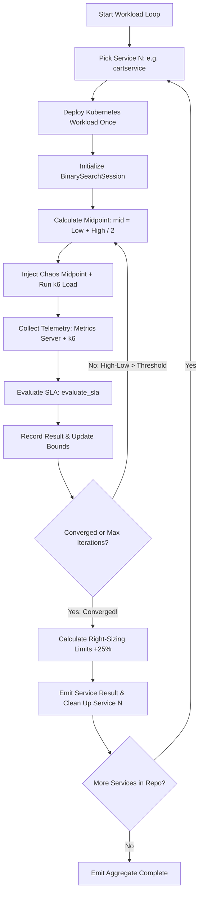

# Implementation Plan: Service-by-Service Multi-Iteration Binary Search Engine

## Executive Summary
Upgrade the **AI K8s Twin** orchestration engine from single-pass heuristic testing to a **true iterative Binary Search Optimization loop**, executed sequentially microservice by microservice:
1. Pick Service 1 (e.g. `cartservice`).
2. Run iterative binary search trials (`Iteration 1 -> 2 -> 3 -> ... -> Converged`).
3. Settle on the maximum safe chaos tolerance and right-sized YAML configuration.
4. Clean up Service 1, then proceed to Service 2 (e.g. `shippingservice`).
5. Live-stream each iteration's midpoint, SLA verdict, and bound adjustments to the dashboard UI.

---

## 1. Architectural Architecture & Lifecycle



---

## 2. Key Technical Improvements

### A. Persistent Deployment with In-Place Chaos Swapping (Fast Iterations)
* **Problem:** If we delete and redeploy the Kubernetes workload on every iteration, 5 iterations would take 10+ minutes per service.
* **Solution:** 
  - Deploy the workload **once** at the start of the service lifecycle.
  - Across iterations $1 \rightarrow 2 \rightarrow 3$, **swap only the Chaos Mesh CRD manifests** (`kubectl delete -f ...` and `kubectl apply -f ...`).
  - If a container crashed (`OOMKilled`), wait a few seconds for Kubernetes to automatically self-heal and restart the pod, then apply the next gentler chaos trial.
  - This reduces each iteration to strictly the experiment duration (e.g. 15–20s), completing all 5 iterations in ~90 seconds!

### B. Iterative Parameter Optimization
* Track search sessions:
  - **Memory Stress Session:** Explores `[16Mi, Max Limit]`.
  - **CPU Stress Session:** Explores `[10%, 100%]`.
  - **Network Latency Session:** Explores `[10ms, 1000ms]`.
* When an iteration fails:
  - If `metrics.oom_killed`: Memory ceiling contracts $\rightarrow \text{High} = \text{mid}$.
  - If `k6.p95_ms > 300ms`: Latency ceiling contracts $\rightarrow \text{High} = \text{mid}$.
  - If `k6.error_rate_percent > 1%`: Network loss / partition contracts $\rightarrow \text{High} = \text{mid}$.
* When an iteration passes:
  - Survived floor moves up $\rightarrow \text{Low} = \text{mid}$, and `best_passing_value = mid`.

### C. Typed SSE Streaming Protocol for Iterations & Step Decisions
Add a real-time event to stream each step, the exact tested values, and the decision taken:
```json
{
  "event": "iteration_update",
  "data": {
    "service": "cartservice",
    "iteration": 2,
    "max_iterations": 4,
    "parameter": "Memory Stress",
    "tested_value": "58M",
    "previous_bounds": ["16M", "100M"],
    "sla_passed": true,
    "reason": "SLA satisfied (Error rate: 0.00%, P95: 110ms)",
    "step_taken": "Raised Lower Bound: [16M, 100M] -> [58M, 100M] (Pushed stress higher)",
    "new_bounds": ["58M", "100M"],
    "next_midpoint": "79M",
    "converged": false
  }
}
```

### D. Iteration Decision Trace (UI Table & Inspector)
For every microservice, the dashboard will render a **Convergence Decision Timeline**:
* **Iteration 1:** Tested `100M` | `✕ BREACHED (OOMKilled)` | **Step:** Contracted Upper Bound `[16M, 150M] ➔ [16M, 100M]` | Next: `58M`
* **Iteration 2:** Tested `58M`  | `✓ PASSED (SLA Met)`     | **Step:** Raised Lower Bound `[16M, 100M] ➔ [58M, 100M]`      | Next: `79M`
* **Iteration 3:** Tested `79M`  | `✓ PASSED (SLA Met)`     | **Step:** Raised Lower Bound `[58M, 100M] ➔ [79M, 100M]`      | Next: `89M`
* **Iteration 4:** Tested `89M`  | `✕ BREACHED (p95: 410ms)`| **Step:** Contracted Upper Bound `[79M, 100M] ➔ [79M, 89M]`    | Next: `84M`
* **Converged:** Tolerance verified at **`79M`** $\rightarrow$ Right-Sized Recommendation: **`99Mi`** (+25% buffer).

---

## 3. Implementation Phases

### Phase 1: Backend Orchestrator Refactor (`environment_orchestrator.py`)
1. In `process_application()`:
   - Check `mode`:
     - If `mode == "heuristic"`: Keep fast single-pass evaluation.
     - If `mode == "binary_search"`: Launch the multi-iteration loop.
2. Initialize `BinarySearchSession` for the target stressors using `calculate_bounds()`.
3. Loop `while not session.converged and iteration < max_iterations`:
   - Compute `next_value()`.
   - Generate and apply chaos YAML.
   - Run k6 load test and wait for duration.
   - Collect metrics and evaluate SLA.
   - Update `session.record_result(tested_value, passed, reason)`.
   - Emit `iteration_update` via `event_emitter`.
4. Derive final right-sized limits based on `session.best_passing_value` and observed peak usage.
5. Tear down chaos and deployment, then advance to next service.

### Phase 2: Frontend Convergence Trace (`App.jsx` & `App.css`)
1. Store iteration histories per service in React state:
   - `services[name].iterations = [ { iteration, tested_value, passed, reason, bounds }, ... ]`.
2. Add an **Iteration Progress Stepper / Trace Table** in the Telemetry Inspector:
   - Visual chips for Iteration 1 $\rightarrow$ Iteration 2 $\rightarrow$ Iteration 3.
   - Shows: Tested Stress | Result (`✓ PASSED` / `✕ FAILED`) | Reason | Bound range `[Low, High]`.
3. Fix Top-Right Badge:
   - If the final converged verdict found a viable passing tolerance $\rightarrow$ `PASSED` (green).
   - If even the lowest baseline failed $\rightarrow$ `FAILED` (red).

---

## 4. Verification & Testing Plan
1. **Unit Test:** Verify `BinarySearchSession` convergence in `test_binary_search_service.py`.
2. **End-to-End Test in WSL:**
   - Run `cartservice` with `mode: binary_search`, `vus: 10`, `duration: 15s`.
   - Verify Iteration 1 tests midpoint, Iteration 2 backs off on failure or pushes higher on success, and Iteration 3 converges.
   - Confirm it transitions smoothly to the next microservice (`shippingservice`).
3. **UI Verification:**
   - Verify the iteration table live-updates in the dashboard inspector without flickering.
