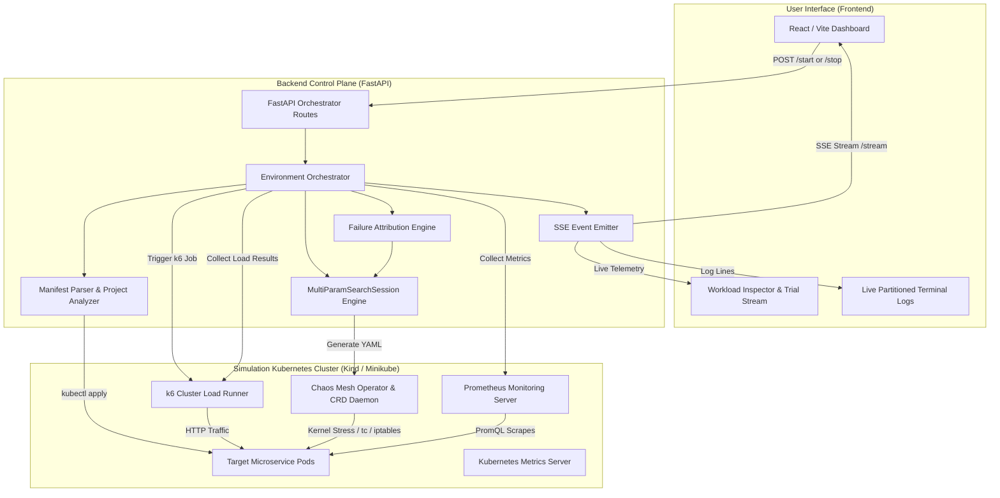
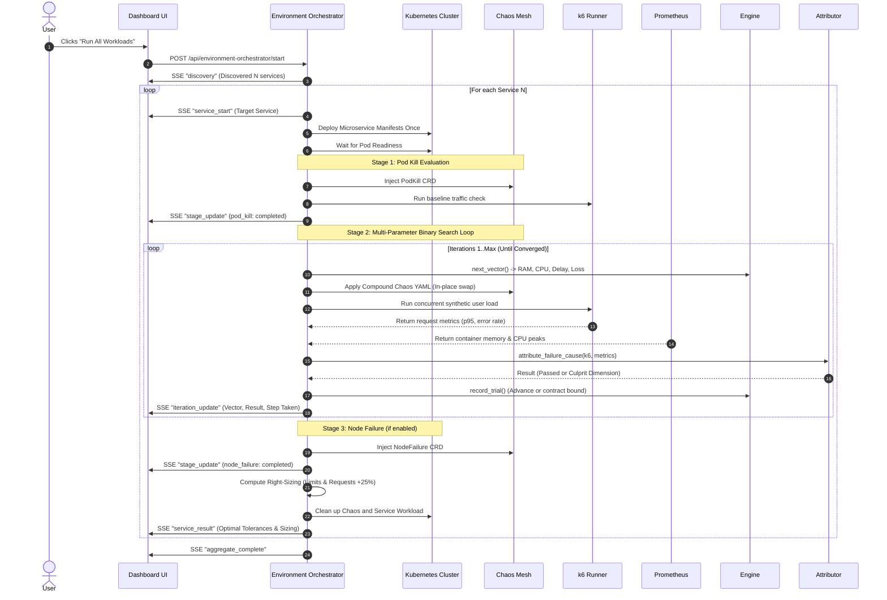

# System Architecture & Data Flow

## 1. High-Level Architectural Diagram

---

## 2. Component Subsystems

### A. Frontend Dashboard (React / Vite)
- Built on modern React with Vite.
- Connects to the backend via a long-lived Server-Sent Events (`EventSource`) connection (`/api/environment-orchestrator/stream`).
- Features:
  - **Microservice Resilience Grid**: Displays all discovered services with statuses (`WAITING`, `RUNNING`, `PASSED`, `FAILED`).
  - **Workload Inspector**: Shows real-time 4-parameter resilience tolerance tiles, dual memory/CPU limits & requests, and observed peaks.
  - **Trial Stream**: Timeline cards displaying applied chaos vectors, culprit failure tags (`[BREACH: LOSS]`, `[BREACH: RAM]`), and bound progressions.
  - **Partitioned Console**: Terminal with toggleable per-service log streams and global system logs.

### B. Backend Control Plane (FastAPI)
- **`environment_orchestrator.py`**: The central coordinator managing service-by-service execution, test phases, manifest generation, and cleanup.
- **`binary_search_service.py`**: Contains `BinarySearchSession` and `MultiParamSearchSession`, managing vector generation, bound adjustments, and failure attribution.
- **`yaml_parser.py` & `project_analyzer.py`**: Parses multi-document YAML manifests, resolving dependencies, containers, limits, requests, and port mappings.
- **`event_emitter.py`**: Thread-safe publisher that broadcasts structured events (`discovery`, `stage_update`, `iteration_update`, `service_result`) across active SSE clients.

### C. Simulation Cluster (Kind or Minikube)
- **Chaos Mesh**: Cloud-native chaos engineering platform injecting stress at the Linux cgroup and kernel network level (`stress-ng`, `tc`, `iptables`).
- **k6 Load Runner**: Runs within the cluster to execute high-volume synthetic user transactions without egress or ingress bottlenecks.
- **Prometheus & Metrics Server**: Collects granular resource consumption metrics (container working set memory and CPU core utilization).

---

## 3. End-to-End Execution Sequence

